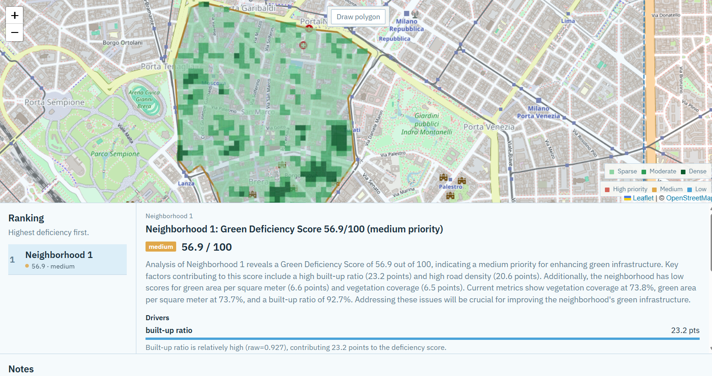
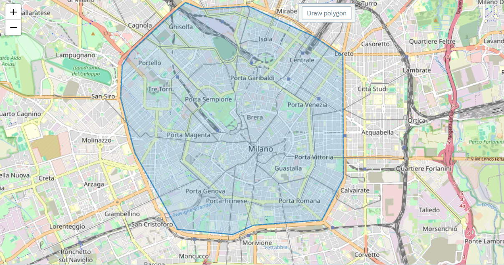
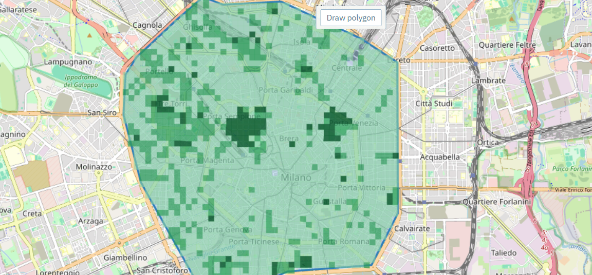
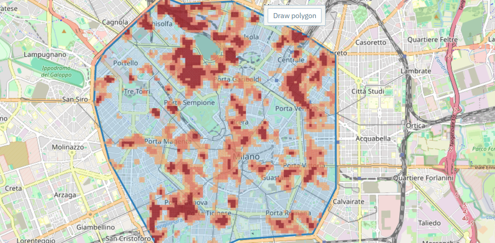
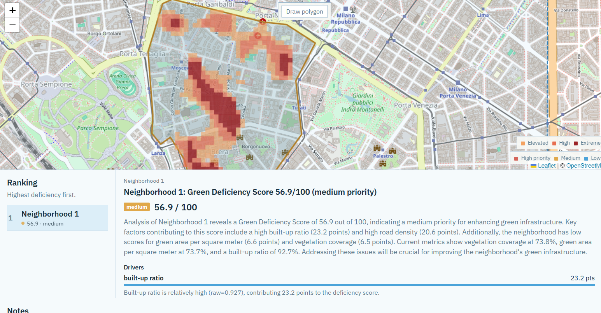

# GreenCity AI

**Decision support for urban green infrastructure.**

GreenCity AI helps planners see *where* neighborhoods need greening and *why*. It ranks areas with an explainable **Green Deficiency Score** built from satellite vegetation (NASA HLS NDVI), OpenStreetMap urban form, and optional population data — then grounds the result in plain-language narratives. An optional LLM rewrites text; it never recomputes the science.

[Features](#features) · [Screenshots](#screenshots) · [Architecture](#architecture) · [Tech stack](#tech-stack) · [Quick start](#quick-start)

---

## Features

| Capability | What it delivers |
|---|---|
| **Map-first workflow** | Register, draw a city boundary, then neighborhood polygons (Leaflet + PostGIS) |
| **Explainable ranking** | 0–100 Green Deficiency Score with contribution breakdown and priority bands |
| **Multi-source vegetation** | NASA HLSS30 NDVI when Earthdata credentials are set; OSM park coverage as fallback |
| **Urban context** | Roads, parks, and buildings from OpenStreetMap (cached Overpass + mirrors) |
| **Map overlays** | Vegetation density, park-access distance, Landsat heat exposure |
| **Agent narratives** | Neighborhood brief, comparison, and climate-aware planting plan grounded in scored facts |
| **Clean Architecture** | Domain scoring isolated from FastAPI, SQLAlchemy, and vendor SDKs |

---

## Screenshots

### Analysis workspace

Draw neighborhoods, rank deficiency, and inspect score drivers in one view.



### Draw a city boundary

Define the study area on an interactive map before adding neighborhoods.



### Vegetation density overlay

Satellite / park-derived vegetation shown as a density grid inside the AOI.



### Heat exposure overlay

Landsat-based surface temperature context for planners evaluating thermal stress.



### Score explainability

Priority bands and weighted drivers (built-up ratio, road density, vegetation, green area).



---

## Scoring model

Four planner-tunable indicators (weights must sum to 1):

| Indicator | Direction |
|-----------|-----------|
| Vegetation coverage | Beneficial (higher → lower deficiency) |
| Green area per m² | Beneficial |
| Road density | Pressure |
| Built-up ratio | Pressure |

Values are normalised (urban benchmarks for a single area, min–max across a cohort of 2+ neighborhoods), mapped to deficiency components, weighted, and scaled to **0–100**. Rank 1 = highest priority.

---

## Architecture

```
React (Leaflet)  ──JWT──►  FastAPI  ──►  Domain (GDS, ranking, reports)
                              │
                              ├── PostgreSQL 16 + PostGIS
                              ├── LangGraph (validate → indicators → score → summarise)
                              ├── NASA HLS / Landsat
                              └── OpenStreetMap Overpass + WorldPop (optional)
```

| Layer | Role |
|-------|------|
| **Domain** | Entities, invariants, Green Deficiency Score, ports |
| **Application** | Use cases (auth, AOIs, jobs, indicators, scoring, reports) |
| **Infrastructure** | PostGIS, imagery, OSM, LangGraph, LLM, email |
| **Presentation** | REST API + React workspace |

Deeper notes: [docs/architecture](docs/architecture/README.md) · [ADRs](docs/adr/README.md)

---

## Tech stack

| Area | Stack |
|------|--------|
| Backend | Python 3.12, FastAPI, Pydantic, SQLAlchemy, Alembic |
| Database | PostgreSQL 16 + PostGIS |
| Spatial / rasters | Shapely, NumPy, Rasterio, earthaccess |
| Orchestration | LangGraph |
| Frontend | React 19, TypeScript, Vite, Leaflet |
| Auth | JWT + bcrypt |
| Tests | pytest (unit + API) |

---

## Quick start

**Requirements:** Docker, Python 3.12+, Node.js 20+.

```bash
# 1. Database
docker compose up -d

# 2. Backend
cd backend
python -m venv .venv
# Windows: .venv\Scripts\activate
# macOS/Linux: source .venv/bin/activate
pip install -e ".[dev]"
alembic upgrade head
uvicorn greencity.main:app --reload --app-dir src
```

API: [http://localhost:8000/docs](http://localhost:8000/docs) · Health: [http://localhost:8000/api/v1/health](http://localhost:8000/api/v1/health)

```bash
# 3. Frontend (second terminal)
cd frontend
npm install
npm run dev
```

UI: [http://localhost:5173](http://localhost:5173)

Copy [`.env.example`](.env.example) to `.env` to override defaults. Only PostGIS runs in Docker; the API and Vite app run on the host.

### Optional integrations

| Variable | Effect if unset |
|----------|-----------------|
| `NASA_EARTHACCESS_USERNAME` / `PASSWORD` | Vegetation uses OSM park coverage; HLS NDVI skipped |
| `OPENAI_API_KEY` | Template reports and narratives (no LLM rewrite) |
| `WORLDPOP_RASTER_PATH` | Uniform population density fallback |
| `EMAIL_ENABLED` + SMTP | Analysis summaries logged instead of emailed |

Change `JWT_SECRET` before any shared deployment.

---

## Tests

```bash
cd backend
pytest
```

Scoring, NDVI stages, OSM parsing, job transitions, and report builders are unit-tested with fakes — no NASA or Overpass required in CI.

---

## Repository layout

```
├── backend/           FastAPI package `greencity` (Clean Architecture)
├── frontend/          React + TypeScript planning workspace
├── docs/              Architecture, ADRs, API notes, diagrams
├── img/               README screenshots
├── docker-compose.yml
└── .env.example
```

---

## License

MIT — see [LICENSE](LICENSE).
